<style>
.markdown-body table thead th { background-color: #1f3864; color: #ffffff; }
.markdown-body img { border: 1px solid #cccccc; border-radius: 4px; }
</style>

# TP VMware vCenter – Déploiement de solution (semaine 1)

| | |
|---|---|
| **Nom, prénom** | Giocanti Paul |
| **Classe** | E1B |
| **Établissement** | Geneva Institute of Technology · Satom IT & Learning Solutions |
| **Module** | Virtualisation – VMware vSphere (ESXi + vCenter Server) |
| **Période** | du 2 au 6 novembre 2026 |
| **Formateur** | Morrad Belrhali |

> ⚠️ **État du rendu : rapport d'avancement.** Ce document présente le travail réalisé du 2 au 4 novembre 2026. Les tâches 1 et 5 sont terminées et validées. Les tâches suivantes (vCenter, cluster, HA, vMotion, Storage vMotion, SDRS…) n'ont pas encore été réalisées : leur état est indiqué honnêtement dans le tableau de la section 4 et dans le tableau de validation (section 10).

---

## Sommaire

1. Conditions de réalisation
2. Présentation de la solution et topologie
3. Tableau de configuration
4. État d'avancement des tâches
5. Préparation : choix de la plateforme
6. Installation d'ESXi sur le serveur physique
7. Tâche 1 – Installation des hôtes ESXi (esxi-01 et esxi-02)
8. Le serveur de stockage NFS (nas-01)
9. Tâche 5 – Stockage partagé
10. Tableau de validation des fonctions
11. Problèmes rencontrés
12. Conclusion

---

## 1. Conditions de réalisation

| Élément | Valeur |
|---|---|
| Serveur physique | HPE ProLiant **DL380 Gen10** (local technique de l'école) |
| Processeurs | 2 × Intel Xeon Gold 6134 @ 3,20 GHz (32 processeurs logiques) |
| Mémoire | 512 Go (511,7 Go utilisables) |
| Stockage | Contrôleur HPE Smart Array P408i-a, disque logique RAID 0 de 558,88 Go |
| Réseau | Carte HPE Ethernet 1 Gb 4 ports 331i + port de gestion iLO 5 |
| Hyperviseur | VMware ESXi 8.0 Update 3 (build 24022510), mode évaluation 60 jours |
| vCenter (prévu) | VMware vCenter Server Appliance 8.0.3 (ISO du partage Teams du cours) |
| Poste d'administration | PC portable Lenovo Legion Pro 5 (Windows 11), relié au serveur par un câble réseau direct |
| Réseau du lab | Réseau **isolé** (sans lien avec le réseau de l'école ni avec Internet) |

---

## 2. Présentation de la solution et topologie

### 2.1 Le principe

Le TP demande deux hôtes ESXi, un serveur de stockage NFS et vCenter. Le seul serveur compatible ESXi 8 disponible au local technique est le HPE DL380 Gen10 (voir section 5). La solution retenue est donc une **infrastructure imbriquée** (*nested*) :

- ESXi est installé **directement sur le serveur physique** : c'est l'hyperviseur « socle » ;
- les deux hôtes du TP, **esxi-01** et **esxi-02**, sont des **VM ESXi** créées dans ce socle ;
- le serveur de stockage **nas-01** est une VM Debian du socle ;
- vCenter (**vcsa-01**) sera déployé dans esxi-01, comme le demande l'énoncé.

> 💡 **Virtualisation imbriquée** : faire tourner un hyperviseur (ESXi) à l'intérieur d'une machine virtuelle. Il faut pour cela que la VM reçoive les instructions de virtualisation du processeur (Intel VT-x/EPT), avec l'option « Exposer l'assistance matérielle à la virtualisation au SE invité ».

### 2.2 Topologie

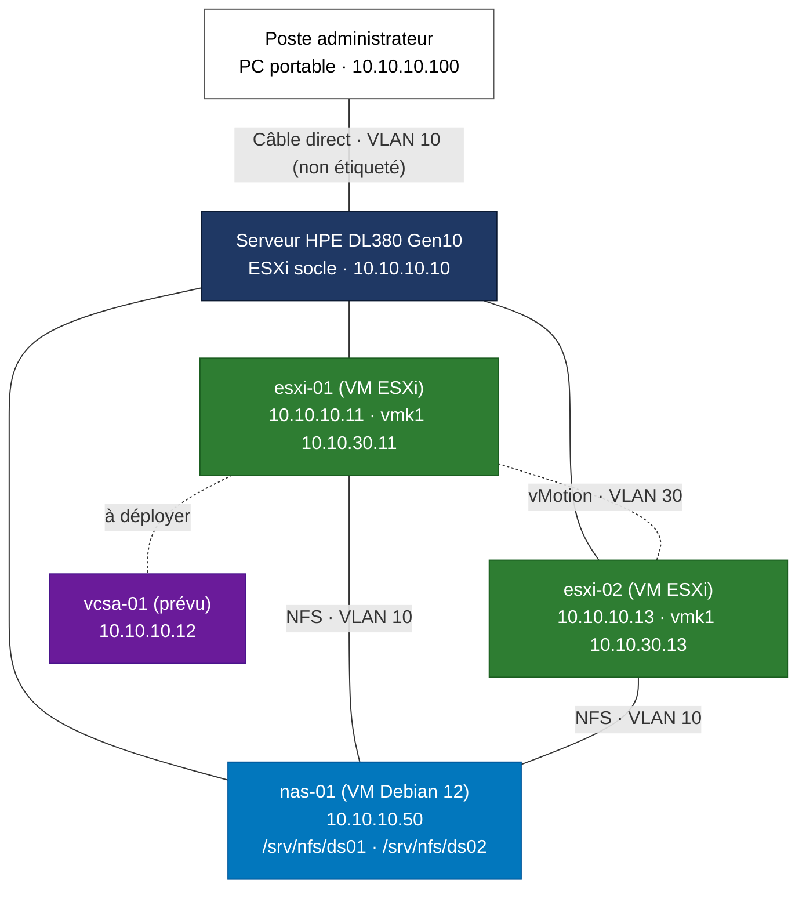

*Figure 0 – Topologie du lab : en bleu marine le serveur physique, en vert les hôtes du TP, en bleu le stockage NFS, en violet vCenter (prévu). Trait plein : réseau d'administration et de stockage (VLAN 10). Pointillés : réseau vMotion (VLAN 30).*

### 2.3 Les VLAN, réalisés en virtuel

Il n'y a pas de switch physique entre les machines : tout le trafic du lab reste à l'intérieur du serveur. Les VLAN 10, 20 et 30 de l'énoncé sont donc créés sur les **switchs virtuels** (vSwitch) d'ESXi.

| Groupe de ports (serveur socle, vSwitch0) | VLAN | Rôle |
|---|---|---|
| VM Network | 0 (non étiqueté) | Réseau d'administration 10.10.10.0/24 (VLAN 10 de l'énoncé), relié au PC par vmnic0 |
| Lab-Trunk | 4095 | « Trunk » : laisse passer tous les VLAN vers esxi-01 et esxi-02, qui créent eux-mêmes leurs VLAN 20 et 30 |
| Lab-VLAN20 | 20 | Réseau des VM 10.10.20.0/24, pour la future passerelle 10.10.20.1 de nas-01 |

> 💡 **VLAN 4095** : valeur spéciale d'ESXi, qui signifie « transmettre les trames avec leur étiquette VLAN, quelle qu'elle soit ». C'est ce qui permet à un ESXi imbriqué de gérer ses propres VLAN.

---

## 3. Tableau de configuration

| Élément | Nom / FQDN | Adresse IP | Détails | État |
|---|---|---|---|---|
| Serveur physique | localhost (ESXi socle) | 10.10.10.10/24 | HPE DL380 Gen10, ESXi 8.0 U3 | ✅ |
| Hôte ESXi 1 | esxi-01.satom.lab | 10.10.10.11/24 | VM : 8 vCPU, 32 Go, disque système 40 Go + disque local 100 Go | ✅ |
| vMotion ESXi 1 | vmk1 | 10.10.30.11/24 | vSwitch1 (vmnic1), groupe « vMotion », VLAN 30 | ✅ |
| Hôte ESXi 2 | esxi-02.satom.lab | 10.10.10.13/24 | VM : 8 vCPU, 32 Go, disque système 40 Go | ✅ |
| vMotion ESXi 2 | vmk1 | 10.10.30.13/24 | vSwitch1 (vmnic1), groupe « vMotion », VLAN 30 | ✅ |
| Stockage NFS | nas-01.satom.lab | 10.10.10.50/24 | VM Debian 12 : 2 vCPU, 2 Go, disque système 16 Go + 2 × 100 Go | ✅ |
| Exports NFS | /srv/nfs/ds01, /srv/nfs/ds02 | — | ext4, 98 Go chacun, réservés au réseau 10.10.10.0/24 | ✅ |
| Datastores partagés | DS-NFS-01, DS-NFS-02 | — | NFS 3, montés sur esxi-01 et esxi-02 | ✅ |
| Datastore local | DS-Local-01 | — | VMFS 6, 100 Go, sur esxi-01 | ✅ |
| Passerelle | (nas-01) | 10.10.10.1 · 10.10.20.1 | à configurer | ⏳ |
| vCenter | vcsa-01.satom.lab | 10.10.10.12/24 | VCSA 8.0.3 | ⏳ |
| Datacenter / cluster | DC-Satom / CL-Lab | — | — | ⏳ |
| VM Debian | vm-deb-01.satom.lab | 10.10.20.21/24 | — | ⏳ |
| VM Windows | vm-win-01.satom.lab | 10.10.20.22/24 | — | ⏳ |
| Poste administrateur | PC portable | 10.10.10.100/24 | adresse fixe sur la carte Ethernet | ✅ |

---

## 4. État d'avancement des tâches

| Tâche | Contenu | Points | État |
|---|---|:-:|---|
| 1 | Installation des hôtes ESXi et vMotion vmk | 2 | ✅ **Terminée** |
| 2 | Déploiement de vCenter (VCSA) | 2 (avec T3) | ⏳ ISO prête, DNS à configurer avant |
| 3 | Inventaire et cluster | | ⏳ |
| 4 | Haute disponibilité (HA) | 3 | ⏳ prérequis stockage partagé en place |
| 5 | Stockage partagé | 2 (avec T7) | ✅ **Terminée** |
| 6 | Groupes de ports VM-Network (VLAN 20) | | ⏳ VLAN 20 préparé sur le socle |
| 7 | Création des VM | | ⏳ |
| 8 | vMotion | 2 | ⏳ réseau vMotion validé (tâche 1) |
| 9 | Storage vMotion | 2 | ⏳ DS-Local-01 et DS-NFS-01 prêts |
| 10 | Storage DRS | 3 | ⏳ DS-NFS-01 et DS-NFS-02 prêts |
| 11 | Snapshots, clones, templates | 2 | ⏳ |
| 12 | Rôles et accès vCenter | 1 | ⏳ |
| 13 | Documentation | 1 | 🟡 rapport d'avancement (ce document) |

---

## 5. Préparation : choix de la plateforme

### 5.1 Première tentative : le PC portable

L'objectif était de monter tout le lab dans VMware Workstation sur mon PC portable (32 Go de RAM), avec ESXi dans des VM. Avant d'installer quoi que ce soit, j'ai testé si le PC acceptait la virtualisation imbriquée, en cochant **VM → Paramètres → Processeurs → Virtualiser Intel VT-x/EPT** sur une VM ESXi, puis en la démarrant.

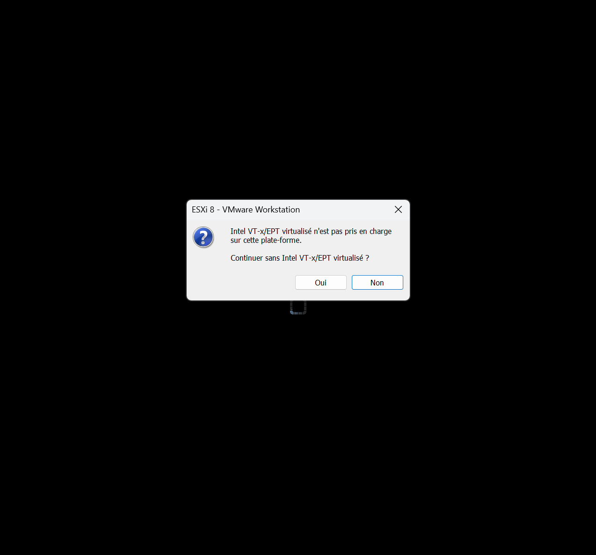
*Figure 1 – VMware Workstation refuse de démarrer la VM ESXi avec la virtualisation imbriquée.*

Le message « Intel VT-x/EPT virtualisé n'est pas pris en charge sur cette plate-forme » montre que **Windows 11 garde le processeur pour son propre hyperviseur**. Malgré plusieurs corrections (détaillées en section 11), la sécurité basée sur la virtualisation (VBS) restait active : le lab était impossible sur ce PC. Comme le formateur l'a indiqué, le TP s'est donc fait sur les **serveurs physiques de l'école**.

### 5.2 Choix du serveur physique

Au local technique, le premier serveur trouvé était un **Dell PowerEdge R710**. Son processeur (génération Intel Westmere, 2010) n'a pas l'instruction XSAVE, exigée par ESXi depuis la version 8.0 Update 2 : l'installation aurait échoué (« Unsupported CPU »). J'ai donc choisi le **HPE ProLiant DL380 Gen10**.

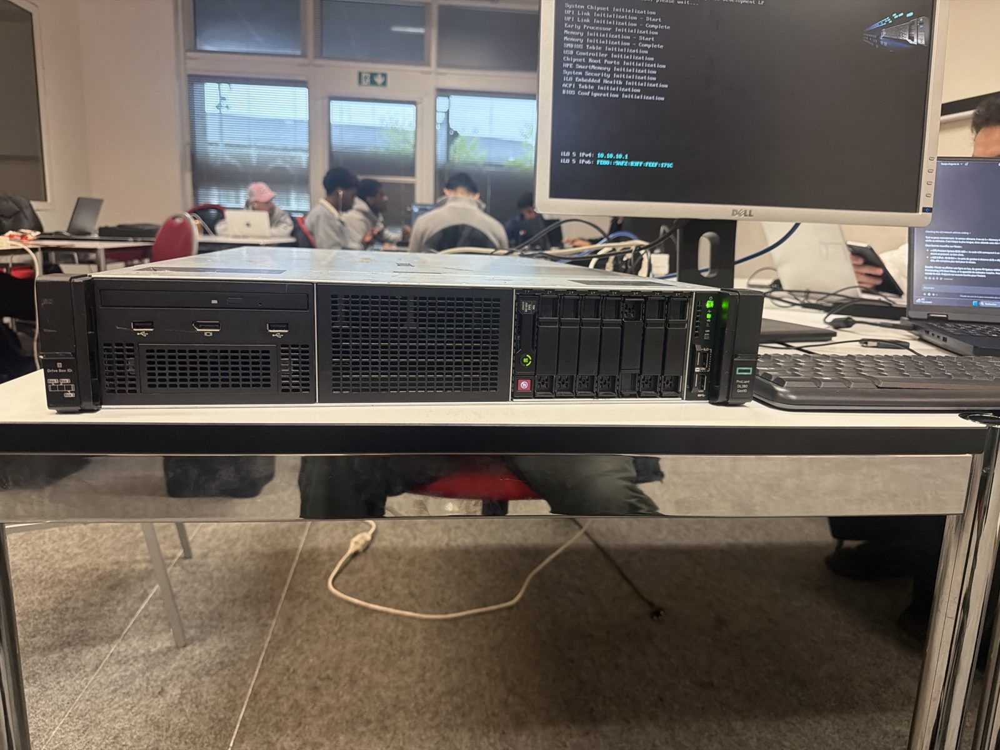
*Figure 2 – Le serveur HPE ProLiant DL380 Gen10 utilisé pour le TP.*

On voit l'étiquette du modèle et le **voyant de santé vert** (à droite) : le serveur démarre sans défaut matériel.

---

## 6. Installation d'ESXi sur le serveur physique

### 6.1 Préparer la clé USB

L'ISO d'ESXi 8.0 U3 (version standard, compatible vCenter) a été copiée sur une clé USB avec **Rufus**, pour rendre la clé démarrable.

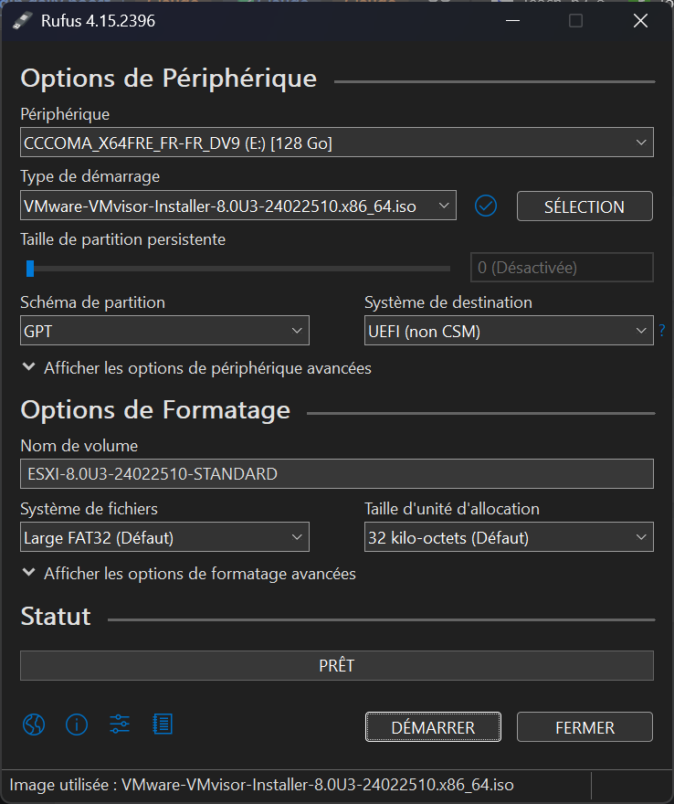
*Figure 3 – Rufus avec l'ISO `VMware-VMvisor-Installer-8.0U3-24022510.x86_64.iso`.*

Rufus a choisi automatiquement le schéma **GPT** et la cible **UEFI**, qui correspondent aux serveurs récents. Le nom de volume « ESXI-8.0U3-…-STANDARD » confirme la version standard d'ESXi : la version gratuite de Broadcom ne peut pas être gérée par vCenter.

### 6.2 Démarrer le serveur sur la clé

À l'allumage, le serveur vérifie d'abord sa mémoire.

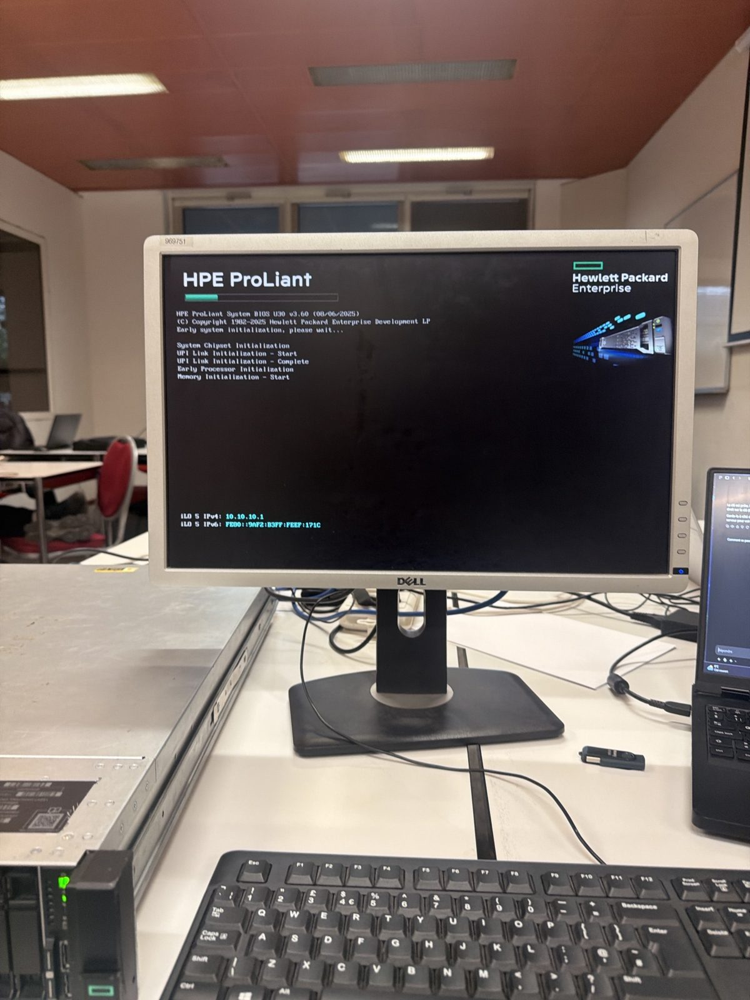
*Figure 4 – Démarrage du serveur (BIOS HPE U30, iLO 5).*

« Memory Initialization – Complete » indique que la mémoire a été testée sans erreur. Le serveur contenait un ancien Windows Server laissé par d'autres élèves : pour démarrer sur la clé USB plutôt que sur le disque, j'ai ouvert le **menu de démarrage avec F11**.

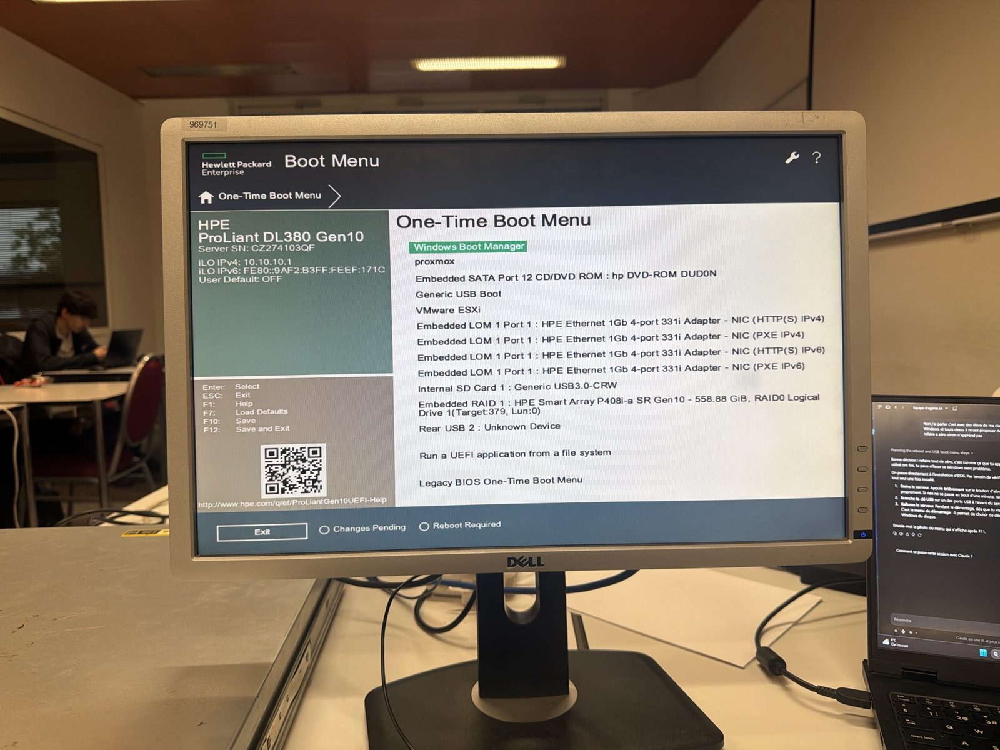
*Figure 5 – Menu de démarrage du serveur (F11).*

Le menu confirme le matériel : le disque logique **Smart Array P408i-a de 558,88 Go**, déjà configuré en RAID 0, et la carte réseau **4 ports 331i**. J'ai choisi **Generic USB Boot**, c'est-à-dire la clé.

### 6.3 L'installation

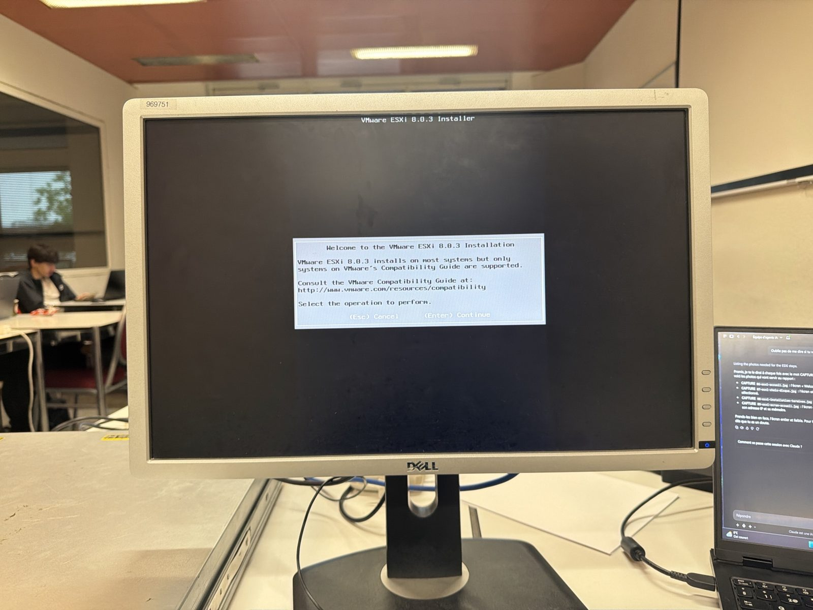
*Figure 6 – Écran d'accueil de l'installateur ESXi 8.0.3.*

L'installateur a bien démarré depuis la clé. Après la licence (F11), il demande le disque de destination.

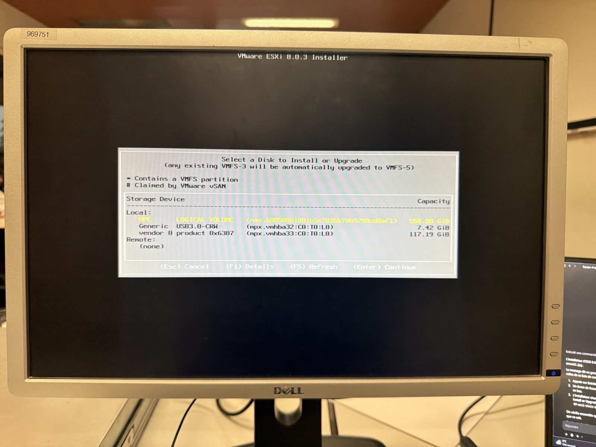
*Figure 7 – Sélection du disque : HPE LOGICAL VOLUME de 558,88 Go.*

Trois périphériques sont proposés : le disque du serveur (**HPE LOGICAL VOLUME, 558,88 Go**, sélectionné), une carte SD interne de 7,42 Go et la clé USB d'installation (117 Go). Bien lire la taille évite d'installer ESXi sur la mauvaise cible. J'ai ensuite choisi le clavier (United Kingdom, celui branché au serveur) et défini le mot de passe root.

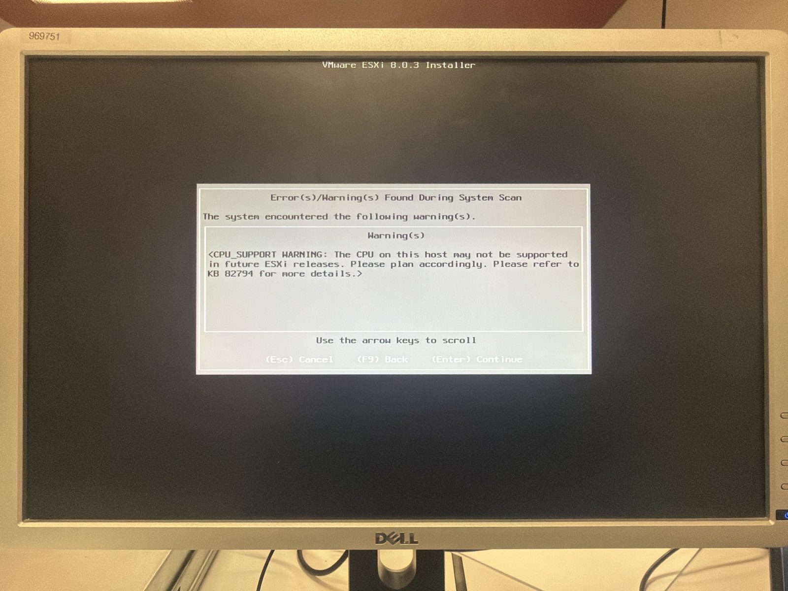
*Figure 8 – Avertissement CPU_SUPPORT pendant l'installation.*

Cet avertissement indique que ce processeur (Xeon Skylake, 2017) **ne sera peut-être plus pris en charge par les futures versions** d'ESXi. Ce n'est pas bloquant pour ESXi 8 : l'installation a continué.

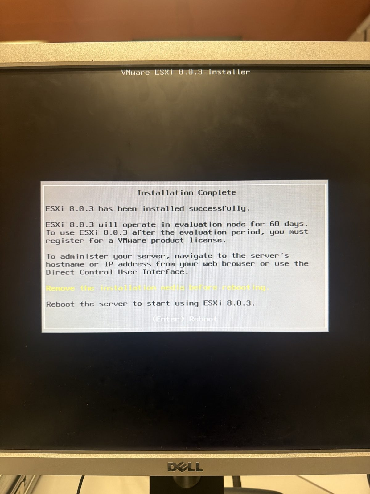
*Figure 9 – « Installation Complete ».*

ESXi 8.0.3 est installé, en **mode évaluation de 60 jours** : toutes les fonctions sont débloquées, y compris le SDRS qui exige normalement la licence Enterprise Plus. Il faut retirer la clé USB avant de redémarrer, sinon le serveur relance l'installateur.

### 6.4 Adresse IP du serveur

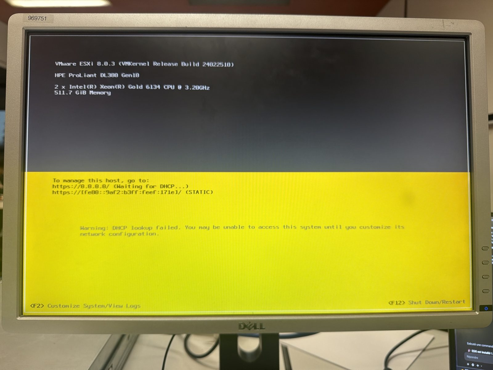
*Figure 10 – Console d'ESXi après redémarrage.*

L'écran confirme les ressources (**2 × Xeon Gold 6134, 511,7 Go de mémoire**). « DHCP lookup failed » est normal : aucun serveur DHCP n'existe sur ce réseau isolé. J'ai donc fixé l'adresse avec **F2 → Configure Management Network → IPv4 Configuration**.

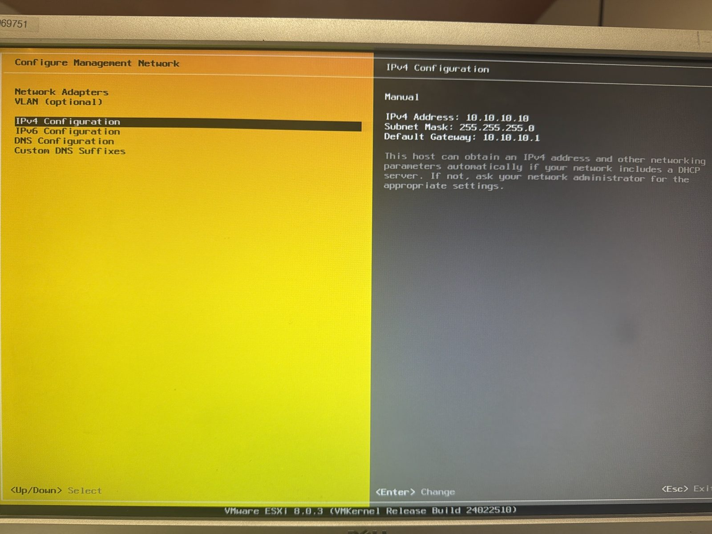
*Figure 11 – Adresse statique 10.10.10.10/24, passerelle 10.10.10.1.*

J'ai choisi **10.10.10.10** : une adresse du réseau d'administration (10.10.10.0/24) que le plan d'adressage n'utilise pas déjà (.11, .12, .13 et .50 sont réservées aux hôtes, à vCenter et au NAS).

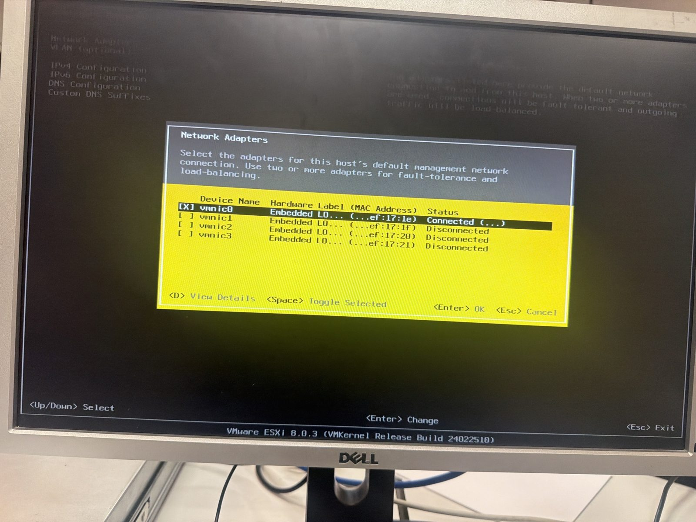
*Figure 12 – Network Adapters : vmnic0 « Connected ».*

Le câble est branché sur le **port 1** de la carte 4 ports (et non sur le port iLO, réservé à la gestion à distance) : vmnic0 affiche « Connected », les trois autres ports « Disconnected ».

### 6.5 Accès depuis le poste d'administration

Pour que le PC et le serveur communiquent, ils doivent être dans le même réseau. J'ai donné une adresse fixe à la carte Ethernet du PC : **Paramètres → Réseau et Internet → Ethernet → Attribution d'IP → Modifier → Manuel**.

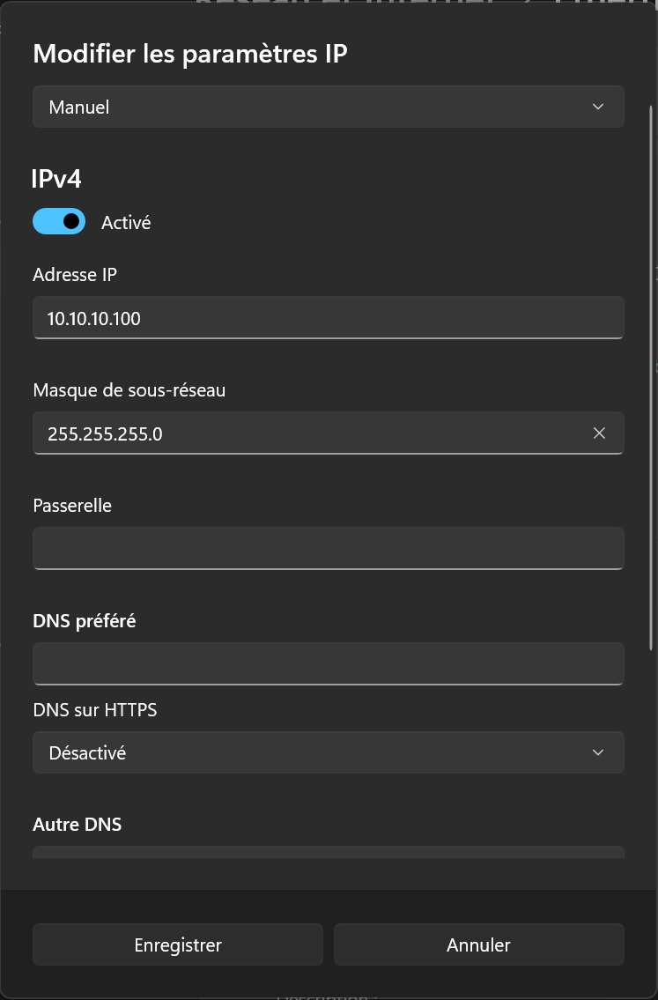
*Figure 13 – PC : 10.10.10.100, masque 255.255.255.0, sans passerelle.*

Le masque 255.255.255.0 (/24) signifie que les trois premiers nombres (10.10.10) désignent le réseau : le PC (.100) et le serveur (.10) sont sur le même réseau et peuvent se parler sans routeur. Le Wi-Fi du PC reste actif pour Internet.

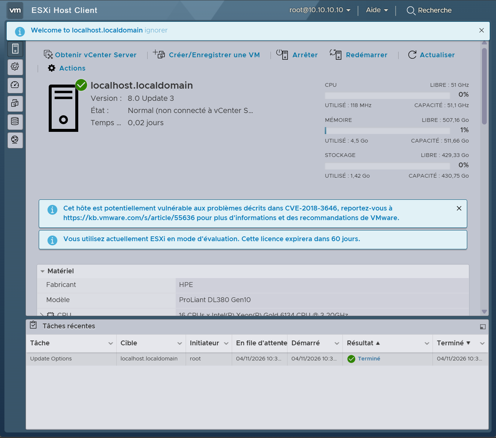
*Figure 14 – ESXi Host Client sur https://10.10.10.10.*

Le serveur s'administre depuis le navigateur du PC : **version 8.0 Update 3**, état normal, mode évaluation, 511 Go de mémoire et 430 Go de stockage local libre (datastore1).

### 6.6 Préparation du socle

Les ISO nécessaires ont été envoyées sur le stockage du serveur : **Stockage → Explorateur de banque de données → dossier ISO → Télécharger**.

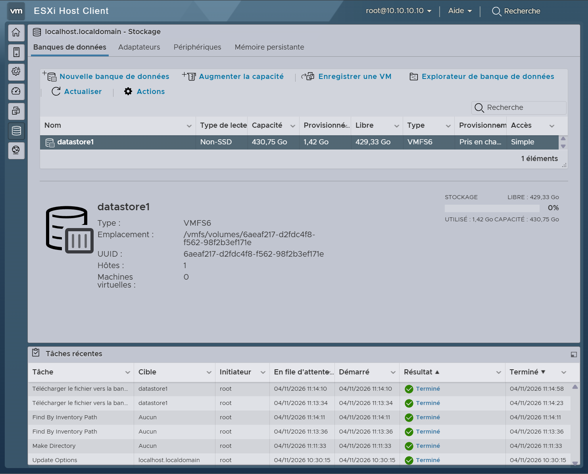
*Figure 15 – Envoi des ISO dans `[datastore1] ISO/`.*

Les deux envois (ISO d'ESXi et ISO de Debian) sont « Terminé ». Les VM du lab pourront démarrer sur ces ISO sans clé USB.

Pour accueillir des ESXi imbriqués, le vSwitch0 du serveur a été modifié (**Mise en réseau → Commutateurs virtuels → vSwitch0 → Modifier les paramètres → Sécurité**) : mode de promiscuité, modifications d'adresse MAC et transmissions forgées sur **Accepter**. Sans ces réglages, le vSwitch bloquerait le trafic des VM hébergées par esxi-01 et esxi-02, car leurs adresses MAC ne sont pas celles des cartes réseau des VM ESXi. Ce réglage est réservé à un lab.

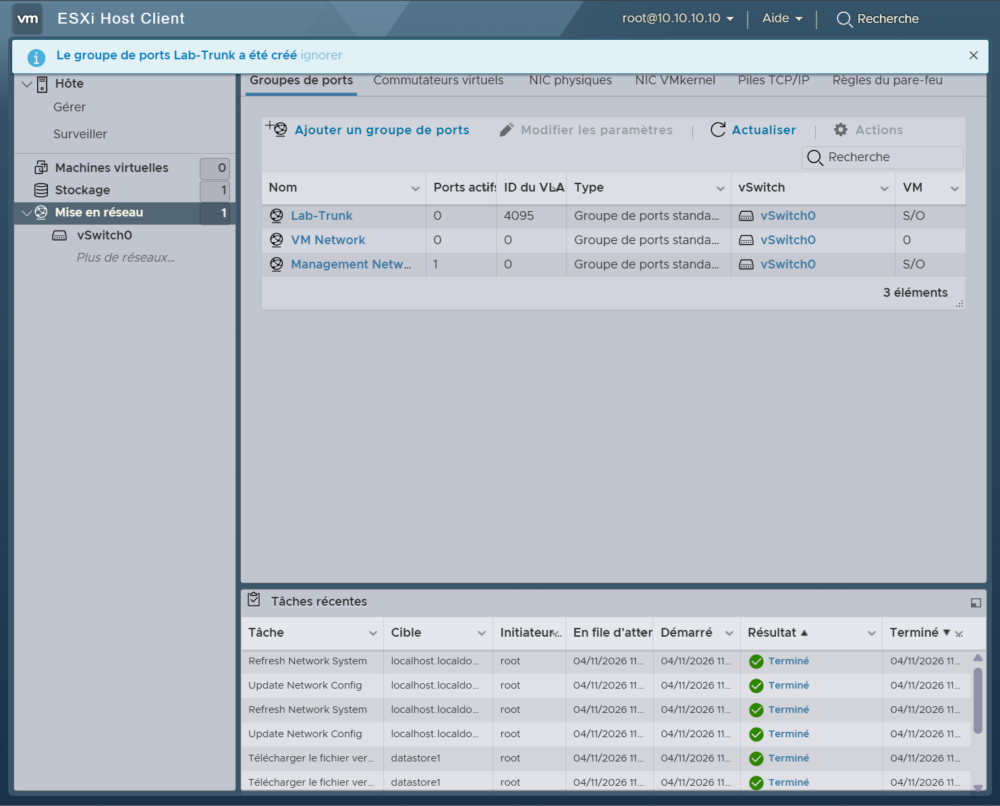
*Figure 16 – Groupes de ports du vSwitch0 : Lab-Trunk (VLAN 4095), VM Network, Management Network.*

Le groupe **Lab-Trunk** (VLAN 4095) laisse passer tous les VLAN : c'est par lui que les hôtes du TP transporteront leurs VLAN 20 et 30.

---

## 7. Tâche 1 – Installation des hôtes ESXi

**Objectif :** installer ESXi 8.x sur esxi-01 et esxi-02, créer sur chacun un VMkernel vmk1 « vMotion » sur le VLAN 30, puis vérifier la connectivité avec `vmkping`.

### 7.1 Création de la VM esxi-01

**Machines virtuelles → Créer/Enregistrer une VM → Créer une nouvelle machine virtuelle**, système invité « Autre → VMware ESXi 8.0 ou version ultérieure ».

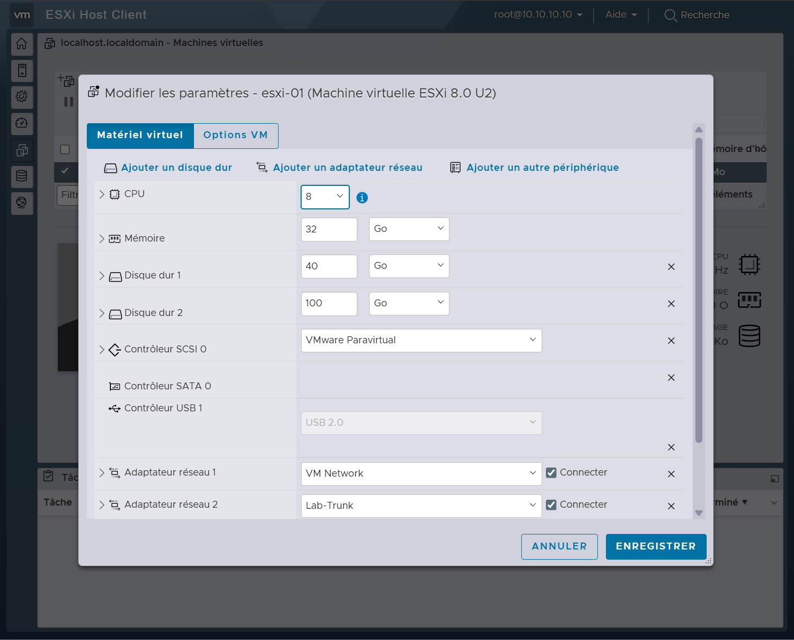
*Figure 17 – esxi-01 : 8 vCPU, 32 Go, disques de 40 Go et 100 Go, cartes réseau VM Network et Lab-Trunk.*

Choix des ressources :
- **8 vCPU, 32 Go de mémoire** : assez pour héberger vCenter (version Tiny, 14 Go) et les VM de test ;
- **disque 1 de 40 Go** (provisionnement dynamique) pour ESXi ;
- **disque 2 de 100 Go**, futur datastore local **DS-Local-01** (tâche 5) ;
- **carte 1 sur VM Network** (administration, 10.10.10.0/24) et **carte 2 sur Lab-Trunk** (VLAN 20 et 30) ;
- option **« Exposer l'assistance matérielle à la virtualisation au SE invité »** cochée, indispensable pour qu'esxi-01 fasse tourner ses propres VM.

> 💡 **Provisionnement dynamique** (*thin*) : le disque virtuel n'occupe sur le serveur que l'espace réellement utilisé, et non sa taille totale.

À la création, ESXi affiche l'avertissement « VMware ne prend pas en charge l'exécution de serveurs ESXi imbriqués dans des environnements de production ». Il signifie seulement que VMware n'offre pas de support technique pour ce montage en production. C'est un montage courant en formation.

### 7.2 Installation d'ESXi dans la VM

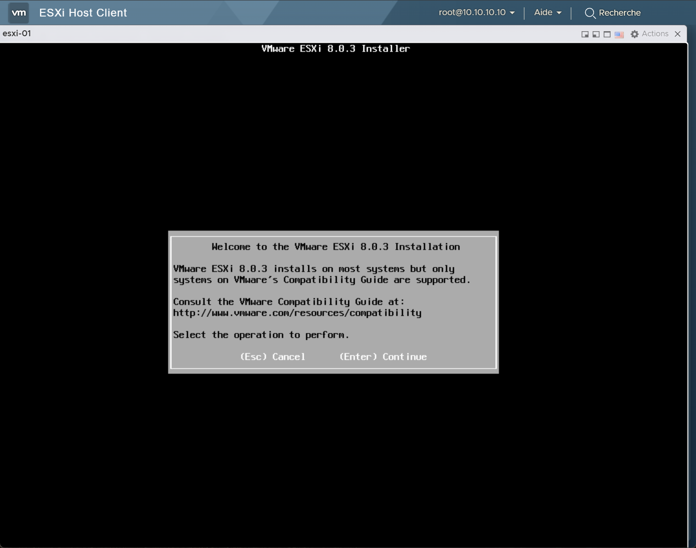
*Figure 18 – L'installateur d'ESXi démarre dans la VM esxi-01 (console du navigateur).*

L'installateur fonctionne dans la VM : la virtualisation imbriquée, impossible sur le PC, fonctionne sur le serveur. J'ai installé ESXi sur le disque de **40 Go** et laissé le disque de 100 Go vide. Clavier : Swiss French (le clavier du PC).

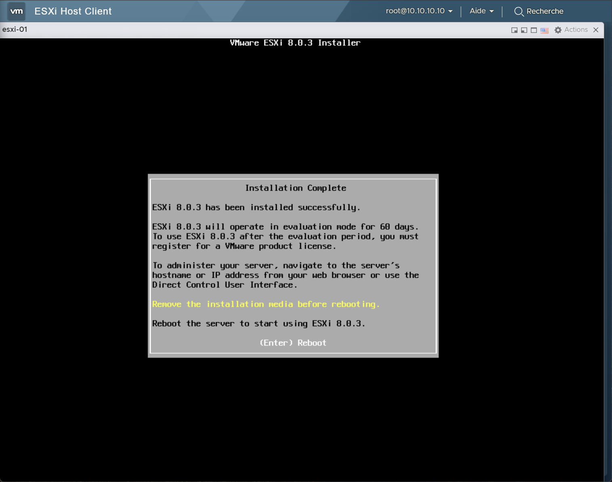
*Figure 19 – ESXi 8.0.3 installé dans esxi-01.*

### 7.3 Adresse, nom et DNS d'esxi-01

Dans la console : **F2 → Configure Management Network** :
- **IPv4 Configuration** : statique, 10.10.10.11 / 255.255.255.0 / passerelle 10.10.10.1 ;
- **DNS Configuration** : serveur DNS 10.10.10.50 (nas-01), nom d'hôte `esxi-01` ;
- **Custom DNS Suffixes** : `satom.lab`.

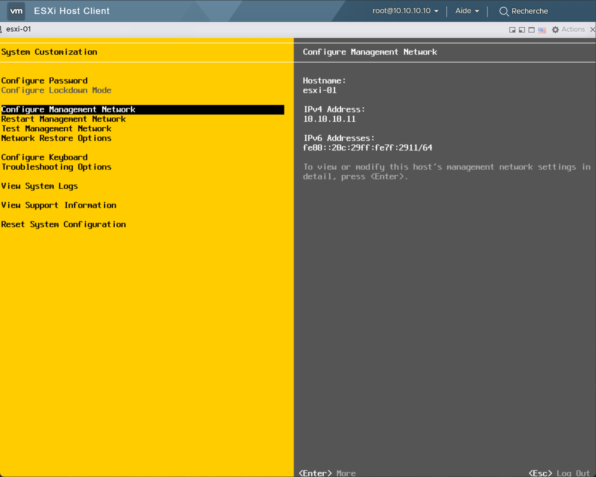
*Figure 20 – esxi-01 : nom d'hôte esxi-01, adresse 10.10.10.11.*

Le panneau de droite confirme le nom et l'adresse du plan d'adressage. Avec le suffixe satom.lab, le nom complet de l'hôte est esxi-01.satom.lab.

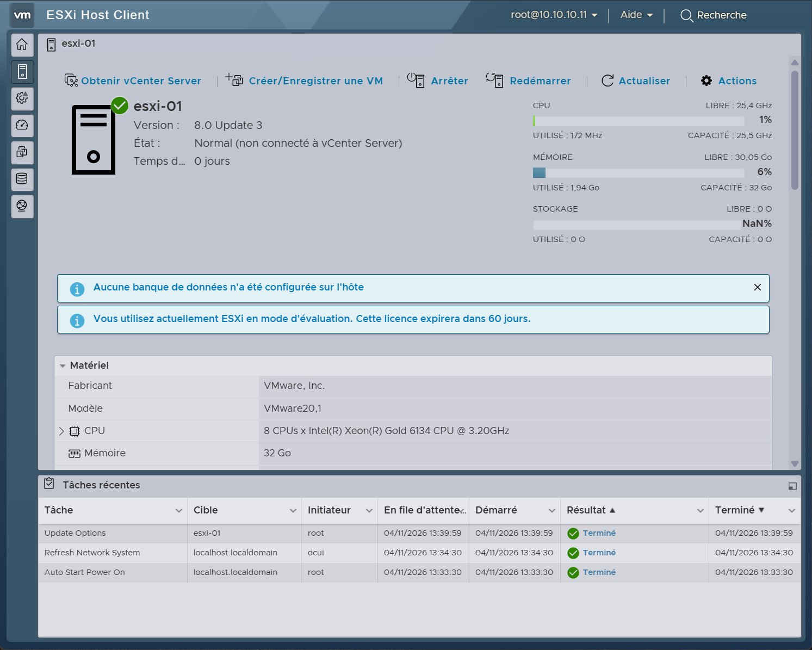
*Figure 21 – esxi-01 administré depuis le PC (https://10.10.10.11).*

esxi-01 répond depuis le PC : 8 CPU, 32 Go, version 8.0 Update 3, mode évaluation. Le message « Aucune banque de données » est normal à ce stade : le disque de 100 Go sera formaté à la tâche 5.

### 7.4 esxi-02

esxi-02 a été créé de la même façon, **sans disque de 100 Go**, puisque l'énoncé ne demande un datastore local que sur esxi-01.

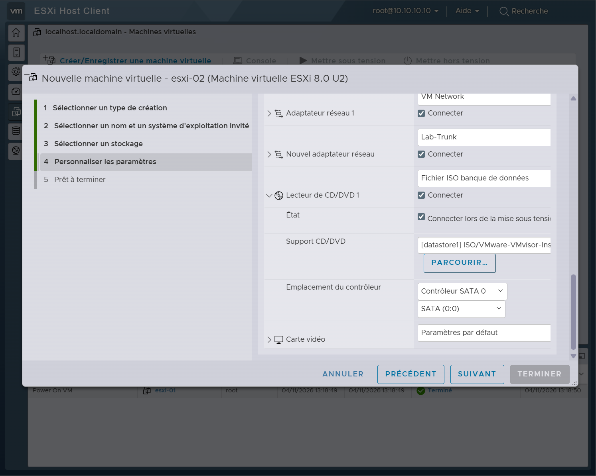
*Figure 22 – esxi-02 : carte 1 VM Network, carte 2 Lab-Trunk, ISO d'ESXi dans le lecteur.*

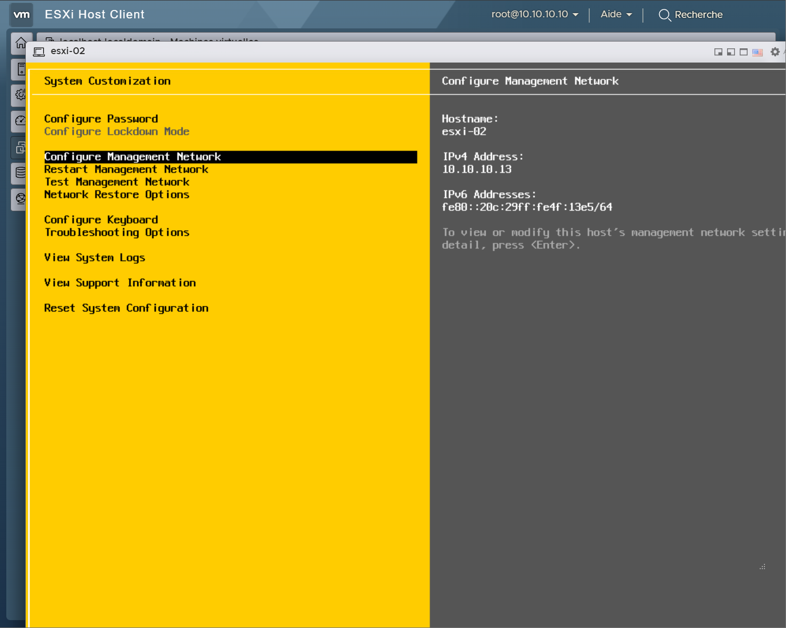
*Figure 23 – esxi-02 : nom d'hôte esxi-02, adresse 10.10.10.13.*

esxi-02 a l'adresse **10.10.10.13**, comme dans le plan d'adressage, avec le même DNS et le même suffixe qu'esxi-01.

### 7.5 VMkernel vMotion (vmk1)

> 💡 **vMotion** : déplacer une VM allumée d'un hôte à l'autre, sans l'arrêter. Pendant la migration, toute la mémoire de la VM passe par le réseau. On lui réserve donc un réseau à part (VLAN 30) pour ne pas ralentir l'administration.
>
> 💡 **VMkernel (vmk)** : carte réseau de l'hôte ESXi lui-même, et non d'une VM. vmk0 sert à l'administration, vmk1 à vMotion.

Sur chaque hôte :
1. **Mise en réseau → Commutateurs virtuels → Ajouter un commutateur virtuel standard** : `vSwitch1`, liaison montante **vmnic1**, c'est-à-dire la 2e carte, reliée à Lab-Trunk ;
2. **NIC VMkernel → Ajouter une NIC VMkernel** : nouveau groupe de ports `vMotion`, vSwitch1, **VLAN 30**, IPv4 statique, service **vMotion** coché.


*Figure 24 – esxi-01 : vmk0 (Gestion, 10.10.10.11) et vmk1 (vMotion, 10.10.30.11).*

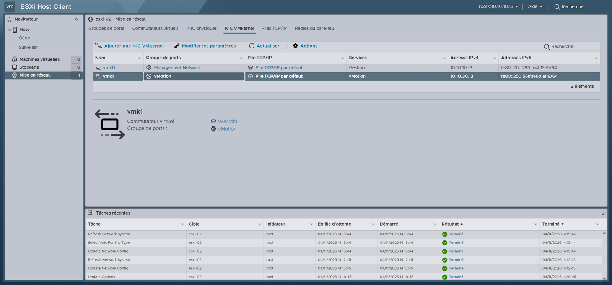
*Figure 25 – esxi-02 : vmk1 (vMotion, 10.10.30.13) sur vSwitch1.*

Les deux hôtes ont une carte **vmk1** dédiée au service vMotion, dans le réseau 10.10.30.0/24 (VLAN 30).

### 7.6 Validation : vmkping

`vmkping` est le ping propre à ESXi. Il se lance dans le shell de l'hôte, ici en SSH : SSH activé temporairement par **Gérer → Services → TSM-SSH → Démarrer**, puis `ssh root@10.10.10.11` depuis le Terminal du PC.

```bash
vmkping -I vmk1 10.10.30.13
```

L'option `-I vmk1` force l'envoi par la carte vMotion : on teste bien le réseau vMotion, et pas le réseau d'administration.

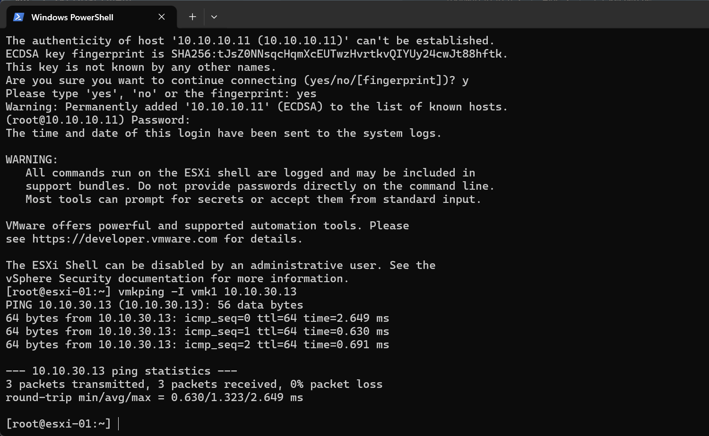
*Figure 26 – vmkping depuis esxi-01 vers esxi-02 par vmk1.*

**3 paquets envoyés, 3 reçus, 0 % de perte**, avec un temps de réponse moyen de 1,3 ms. Le réseau vMotion fonctionne entre les deux hôtes. Après le test, le service SSH a été arrêté, pour ne pas laisser une porte d'accès ouverte.

✅ **La tâche 1 est terminée.**

---

## 8. Le serveur de stockage NFS (nas-01)

Le prérequis « serveur NFS nas-01.satom.lab (10.10.10.50) avec deux exports /srv/nfs/ds01 et /srv/nfs/ds02 de 100 Go » a été réalisé avec une VM Debian 12.

> 💡 **NFS** (*Network File System*) : protocole qui permet de partager un dossier sur le réseau. Les deux hôtes ESXi y rangeront les fichiers de leurs VM. Comme ils voient **le même stockage**, une VM peut passer d'un hôte à l'autre sans être recopiée : c'est la base de vMotion et de la HA.

### 8.1 La VM nas-gw

Un groupe de ports **Lab-VLAN20** (VLAN 20) a d'abord été ajouté au socle, pour que cette VM puisse devenir la passerelle 10.10.20.1 du réseau des VM.

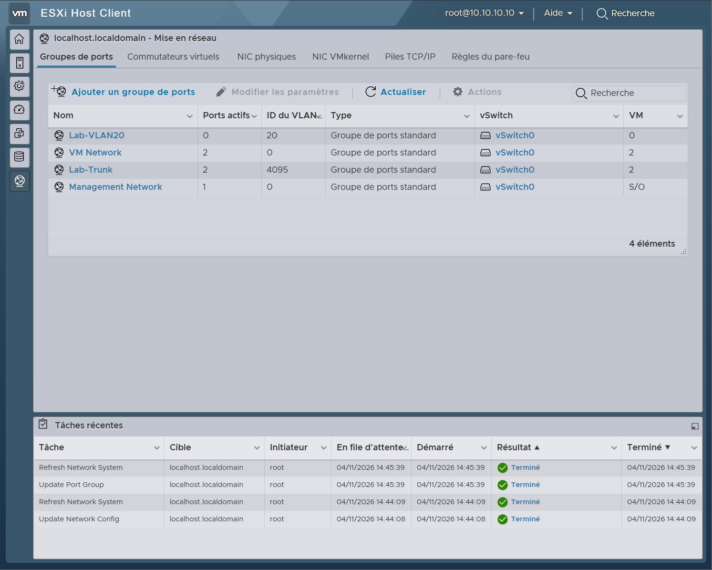
*Figure 27 – Groupes de ports du socle, dont Lab-VLAN20 (VLAN 20).*

On voit aussi que **VM Network** et **Lab-Trunk** sont utilisés chacun par 2 VM, esxi-01 et esxi-02 : le câblage virtuel des hôtes est correct.

VM **nas-gw** : 2 vCPU, 2 Go, un disque système de 16 Go et **deux disques de 100 Go** (provisionnement dynamique), carte 1 sur VM Network, carte 2 sur Lab-VLAN20. Debian 12.15 a été installé depuis l'ISO **DVD-1**, et non la petite ISO « netinst », parce que le lab n'a pas Internet. Réglages : adresse 10.10.10.50/24, nom `nas-01`, domaine `satom.lab`, installation sur le disque de 16 Go uniquement, sans environnement graphique, avec le **serveur SSH**.

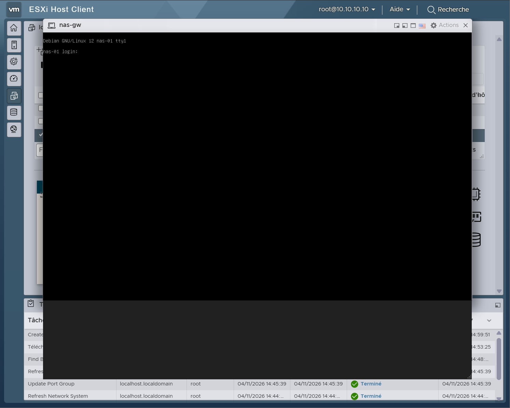
*Figure 28 – Debian 12 démarré : « nas-01 login: ».*

### 8.2 Les disques de stockage

Connexion depuis le PC avec `ssh lami@10.10.10.50`, puis `su -` pour passer administrateur. La connexion SSH directe en root est interdite par défaut sous Debian : c'est une bonne pratique de sécurité.

```bash
ip -br a ; lsblk
```

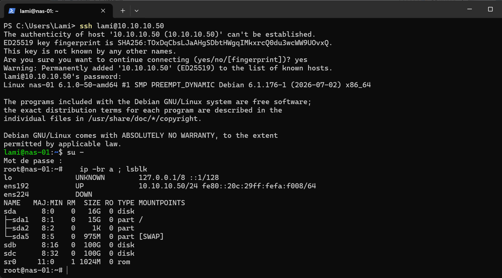
*Figure 29 – Cartes réseau (ens192, ens224) et disques (sda, sdb, sdc) de nas-01.*

`ens192` porte l'adresse 10.10.10.50. `ens224`, sur le VLAN 20, sera configurée pour la passerelle. Debian occupe `sda` (16 Go). **`sdb` et `sdc` (100 Go) sont vides** : ce seront les deux exports.

```bash
mkfs.ext4 -L ds01 /dev/sdb          # formate le disque et lui donne le nom ds01
mkfs.ext4 -L ds02 /dev/sdc
mkdir -p /srv/nfs/ds01 /srv/nfs/ds02 # crée les dossiers demandés par l'énoncé
echo 'LABEL=ds01 /srv/nfs/ds01 ext4 defaults 0 2' >> /etc/fstab   # montage automatique au démarrage
echo 'LABEL=ds02 /srv/nfs/ds02 ext4 defaults 0 2' >> /etc/fstab
systemctl daemon-reload
mount -a                             # monte tout ce qui est listé dans /etc/fstab
df -h /srv/nfs/ds01 /srv/nfs/ds02    # vérifie
tune2fs -m 0 /dev/sdb ; tune2fs -m 0 /dev/sdc   # supprime les 5 % réservés à root
```

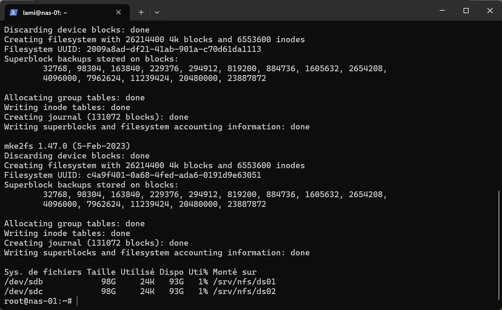
*Figure 30 – /dev/sdb monté sur /srv/nfs/ds01 et /dev/sdc sur /srv/nfs/ds02 (98 Go chacun).*

Les deux disques sont montés aux chemins exacts de l'énoncé. Par défaut, ext4 réserve 5 % de l'espace à root : ces 5 % ont été libérés avec `tune2fs -m 0`, pour que l'espace vu par les ESXi corresponde au disque (utile pour le seuil de 80 % du SDRS).

### 8.3 Le serveur NFS

```bash
apt install -y /tmp/nfs-kernel-server_2.6.2-4+deb12u1_amd64.deb
echo '/srv/nfs/ds01 10.10.10.0/24(rw,sync,no_subtree_check,no_root_squash)' >> /etc/exports
echo '/srv/nfs/ds02 10.10.10.0/24(rw,sync,no_subtree_check,no_root_squash)' >> /etc/exports
systemctl restart nfs-server
exportfs -v
```

Le paquet `nfs-kernel-server` n'est pas sur le DVD-1 de Debian. Il a été récupéré depuis le dépôt officiel de Debian, puis copié sur nas-01 (voir section 11, problème 8).

| Option | Rôle |
|---|---|
| `10.10.10.0/24` | Seules les machines du réseau d'administration (les hôtes ESXi) ont accès au partage |
| `rw` | Lecture et écriture |
| `sync` | Les écritures sont confirmées une fois réellement enregistrées sur le disque |
| `no_root_squash` | ESXi accède au partage en root : sans cette option, il ne pourrait pas créer ses fichiers de VM |

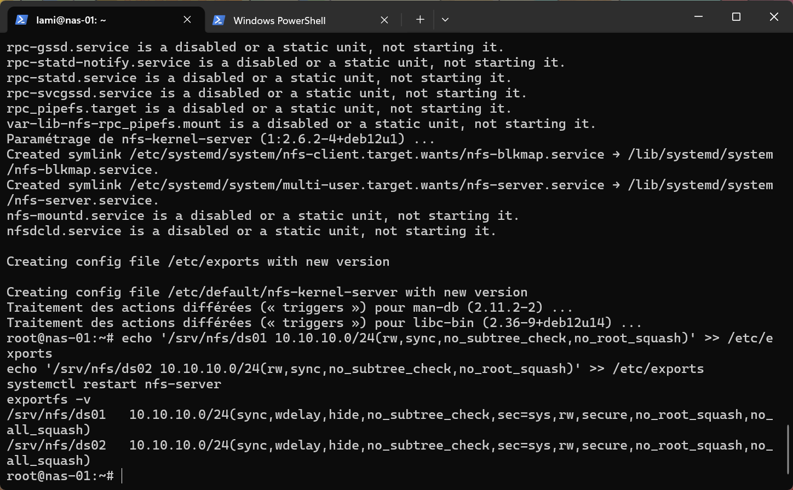
*Figure 31 – `exportfs -v` : /srv/nfs/ds01 et /srv/nfs/ds02 partagés pour 10.10.10.0/24.*

Les deux dossiers sont partagés en lecture et écriture (`rw`) avec `no_root_squash`, uniquement pour le réseau 10.10.10.0/24.

---

## 9. Tâche 5 – Stockage partagé

**Objectif :** monter DS-NFS-01 et DS-NFS-02 sur les deux hôtes, vérifier qu'ils sont visibles des deux côtés, et conserver DS-Local-01 sur esxi-01.

Sur chaque hôte : **Stockage → Nouvelle banque de données → Monter une banque de données NFS** (version NFS 3).

| Nom | Serveur NFS | Partage |
|---|---|---|
| DS-NFS-01 | 10.10.10.50 | /srv/nfs/ds01 |
| DS-NFS-02 | 10.10.10.50 | /srv/nfs/ds02 |

Les noms sont **identiques sur les deux hôtes** : c'est ainsi que vCenter reconnaîtra un seul et même datastore partagé.

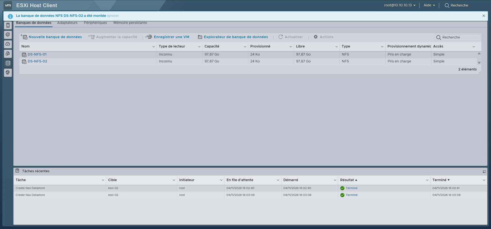
*Figure 32 – esxi-02 : DS-NFS-01 et DS-NFS-02 montés (NFS, 97,87 Go chacun).*

DS-Local-01 a ensuite été créé sur esxi-01, avec son disque local de 100 Go : **Nouvelle banque de données → Créer une banque de données VMFS**, tout l'espace disque, VMFS 6.

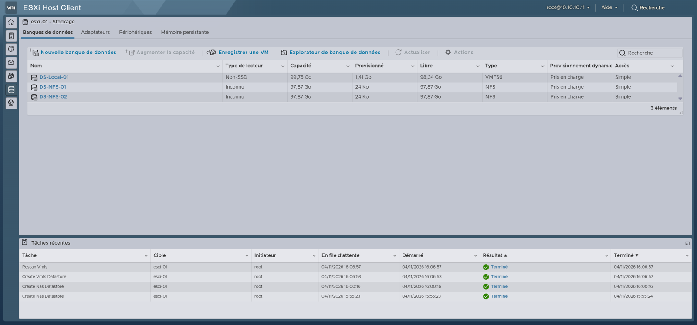
*Figure 33 – esxi-01 : DS-Local-01 (VMFS 6, 99,75 Go), DS-NFS-01 et DS-NFS-02 (NFS, 97,87 Go).*

esxi-01 voit ses trois banques de données, et esxi-02 voit les deux mêmes datastores NFS : **le stockage partagé fonctionne**. C'est le prérequis de la HA (heartbeat sur DS-NFS-01), de vMotion, de Storage vMotion (DS-NFS-01 ↔ DS-Local-01) et du SDRS (DS-NFS-01 + DS-NFS-02).

✅ **La tâche 5 est terminée.**

---

## 10. Tableau de validation des fonctions

| Fonction | Prérequis validé | Test | Critère de réussite | État / preuve |
|---|---|---|---|---|
| HA | 2 hôtes ✅, heartbeat DS-NFS-01 ✅ (vCenter ⏳) | Panne brutale d'esxi-02 | vm-deb-01 redémarre sur esxi-01 en moins de 5 min | ⏳ Non réalisé |
| vMotion | vmk1 VLAN 30 ✅ (figure 26), 2 hôtes ✅ | Migration de vm-deb-01 allumée | 0 à 1 perte de ping | ⏳ Non réalisé |
| Storage vMotion | 2 datastores ✅ (figure 33) | DS-NFS-01 → DS-Local-01 → DS-NFS-01 | Disque déplacé sans arrêt | ⏳ Non réalisé |
| SDRS | Licence d'évaluation ✅, DS-NFS-01/02 ✅ | Remplissage de DS-NFS-01 au-delà de 80 % | Recommandation puis application | ⏳ Non réalisé |

---

## 11. Problèmes rencontrés

| # | Problème | Cause | Solution |
|---|---|---|---|
| 1 | Sur le PC, VMware Workstation refuse de lancer ESXi : « Intel VT-x/EPT virtualisé n'est pas pris en charge » (figure 1) | Windows 11 garde la sécurité basée sur la virtualisation (VBS) active : son hyperviseur occupe le processeur | Tentatives : intégrité de la mémoire désactivée, Hyper-V décoché, `bcdedit /set hypervisorlaunchtype off`, registre `EnableVirtualizationBasedSecurity = 0`. VBS restait « En cours d'exécution » : tout a été remis comme avant, et le TP s'est fait sur un serveur de l'école |
| 2 | Dell PowerEdge R710 inutilisable | Processeur Westmere sans instruction XSAVE, exigée par ESXi 8.0 U2 et plus | Choix du HPE DL380 Gen10 |
| 3 | Un Windows Server d'anciens élèves était installé sur le HPE | Serveur réutilisé d'un TP précédent | Démarrage sur la clé (F11) et réinstallation complète d'ESXi |
| 4 | Avertissement CPU_SUPPORT pendant l'installation (figure 8) | Les Xeon Skylake seront abandonnés par les futures versions d'ESXi | Simple avertissement, sans effet sur ESXi 8 |
| 5 | Un seul serveur compatible pour deux hôtes | Matériel disponible au local technique | ESXi imbriqués, avec la virtualisation matérielle exposée aux VM |
| 6 | Pas de switch physique pour les VLAN | Le serveur est relié directement au PC | VLAN créés sur les vSwitch : Lab-Trunk (4095), Lab-VLAN20 (20), groupes vMotion (30), sécurité du vSwitch0 sur « Accepter » |
| 7 | La touche F11 ouvrait « Lenovo Smart Connect » au lieu d'être envoyée à la console | Sur le PC portable, F1–F12 font d'abord une fonction spéciale | **Fn + F11** |
| 8 | `apt install nfs-kernel-server` : « n'a pas de version susceptible d'être installée » | Le lab n'a pas Internet, et le DVD-1 de Debian ne contient que les paquets les plus courants : `nfs-common` y est, mais pas `nfs-kernel-server` | Diagnostic avec `ls /media/cdrom/pool/main/n/nfs-utils/` et `apt-cache policy`. Paquet officiel (même version que nfs-common) téléchargé sur deb.debian.org, copié avec `scp`, puis installé avec `apt install` sur le fichier .deb (les dépendances viennent du DVD) |
| 9 | Lecteur DVD vide sur nas-01 après l'installation | L'installateur Debian éjecte le DVD à la fin | Reconnecter le lecteur dans les paramètres de la VM |
| 10 | Seulement 93 Go libres sur des disques de 98 Go | ext4 réserve 5 % de l'espace à root | `tune2fs -m 0` |

**Bonnes pratiques de sécurité appliquées**
- SSH activé sur esxi-01 uniquement le temps du test `vmkping`, puis arrêté.
- Connexion à nas-01 avec un compte utilisateur, puis `su -` : root ne peut pas se connecter directement en SSH.
- Exports NFS limités au réseau 10.10.10.0/24.
- Lab isolé du réseau de l'école.
- Aucun mot de passe dans ce rapport ni sur les captures.

---

## 12. Conclusion

### Bilan
En partant d'un serveur à réinstaller, j'ai mis en place la base complète du lab : ESXi sur le serveur physique, deux hôtes ESXi imbriqués avec leur réseau vMotion validé (**tâche 1**), et un serveur NFS dont les deux exports sont montés sur les deux hôtes, avec en plus le datastore local (**tâche 5**). Tous les prérequis de vMotion, Storage vMotion, HA et SDRS sont en place.

Le reste du TP n'a pas pu être réalisé dans les délais. Une grande partie du temps est partie dans le choix de la plateforme : l'échec de la virtualisation imbriquée sur le PC, puis la recherche d'un serveur compatible. C'était aussi ma première utilisation d'un serveur physique, avant le cours de réseau.

### Prochaines étapes
1. Passerelle (10.10.10.1 et 10.10.20.1) et DNS (enregistrements de satom.lab) sur nas-01. Le DNS est obligatoire pour déployer la VCSA.
2. Déploiement de vcsa-01, datacenter DC-Satom, cluster CL-Lab.
3. VM-Network (VLAN 20), vm-deb-01 et vm-win-01, puis les tests HA, vMotion, Storage vMotion et SDRS, les snapshots, les clones et les rôles.

### Compétences acquises
- Identifier si un matériel est compatible avec un hyperviseur (processeur, contrôleur de disques).
- Préparer un support d'installation (Rufus) et installer ESXi sur un serveur physique (menu de démarrage, choix du disque).
- Comprendre et diagnostiquer la virtualisation imbriquée (VT-x/EPT, VBS de Windows).
- Adressage IP statique et notion de réseau (/24), VLAN et trunk (4095), switchs virtuels, VMkernel.
- Tester un réseau dédié avec `vmkping -I`.
- Administrer Debian à distance (SSH, `su -`, `scp`), préparer des disques (`mkfs`, `/etc/fstab`, `mount`), installer un paquet hors ligne et configurer un serveur NFS (`/etc/exports`).
- Monter des datastores NFS et VMFS sur ESXi.
